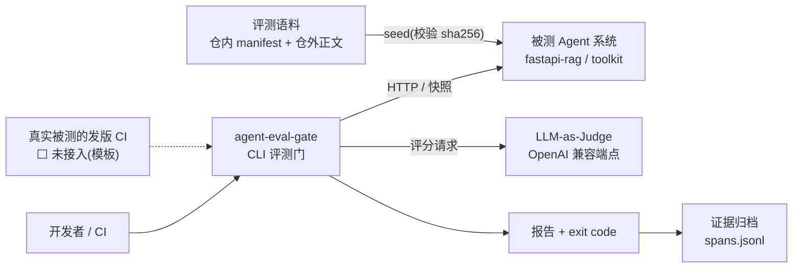
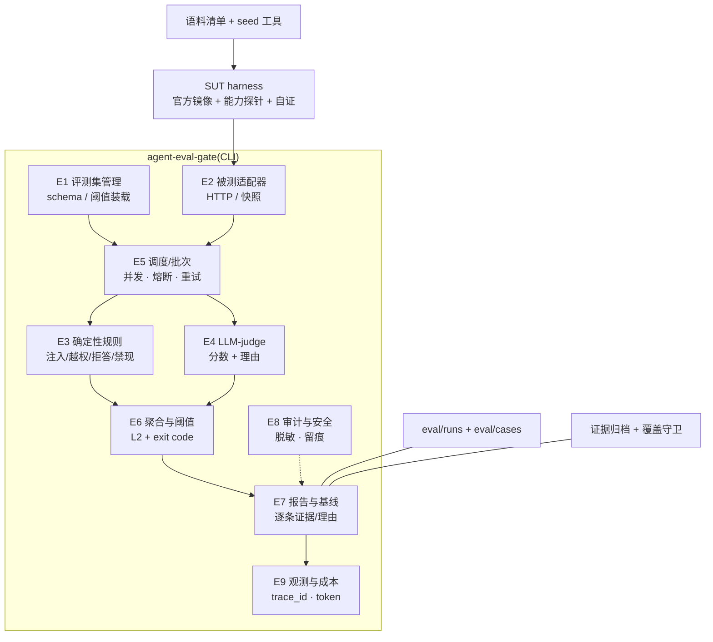
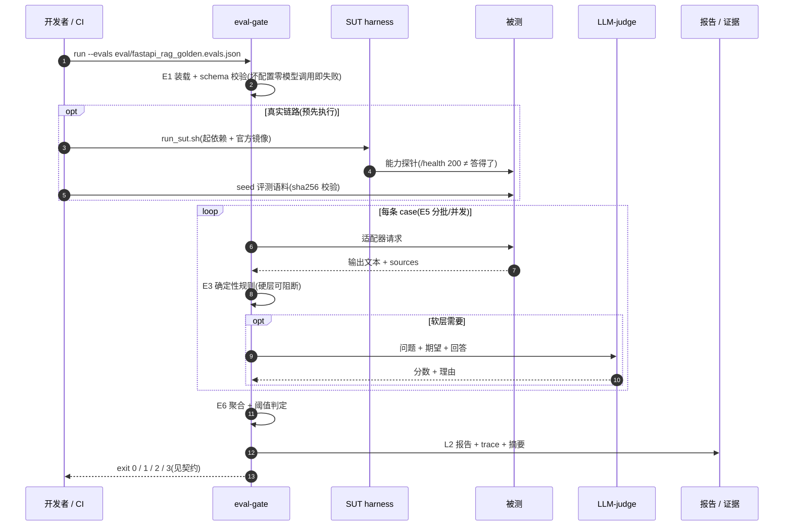

# docs/arch · 当前架构图(C4 视角,2026-10-18)

> **用途**:把「系统现在长什么样」画清楚,避免后来人从历史文档里拼出一个过期架构。
> 事实源:`总纲.md §1`(七层)与 `§3`(E1–E9 模块);本文只画**当前形态**,不重复模块细节。
>
> **图例**:实线 = 已落地并验证;虚线 = **未接线 / 未接入**(不是已实现)。

## 1. C4-L1:系统上下文

**当前边界(2026-10-18 结项)**:

- 被测系统由**它自己的**进程/容器运行;本门只通过适配器取输出,**不托管 Agent 运行时**;
- 真实发版 CI **未接入** —— 模板在 `integrations/fastapi-rag-agent/`;
- 评测语料正文**不在公开仓**,只留清单与哈希。

## 2. C4-L2:容器 / 组件

| 关注点 | 落点 |
|---|---|
| 判据分层(硬层 / 软层 / 第三态) | `DEC-004` · `DEC-022` · `app/eval_gate/rules.py` |
| 调度顺序锁(确定性 → judge) | `runner.py` · 契约测试 |
| 真实被测运行 | `tools/sut-harness/run_sut.sh` |
| 语料复现 | `eval/corpus/manifest.json` + `tools/seed_eval_corpus.py` |
| 证据可重算 | `tools/archive_evidence.py` + `tools/check_evidence_coverage.py` |
| 发版 CI 接入(未做) | `integrations/fastapi-rag-agent/` |

## 3. 一次 live run 的时序

## 4. 与历史图的关系

- `总纲.md §1` 的七层图是**职责适配**层面的蓝图,长期稳定;
- 本文是**当前部署/组件形态**,会随工具链变化(例如将来接入发版 CI);
- **改架构必须同时改两处**:本文 + `总纲.md §1.1`,否则两份图会漂移。

## 变更记录

- 2026-10-18 建立(自用版结项):补上此前只在 `总纲.md` 里被引用、但**目录不存在**的 `docs/arch`;
  当前形态 = 评测内核 + SUT harness + 语料复现 + 证据归档;发版 CI 标为未接入。
